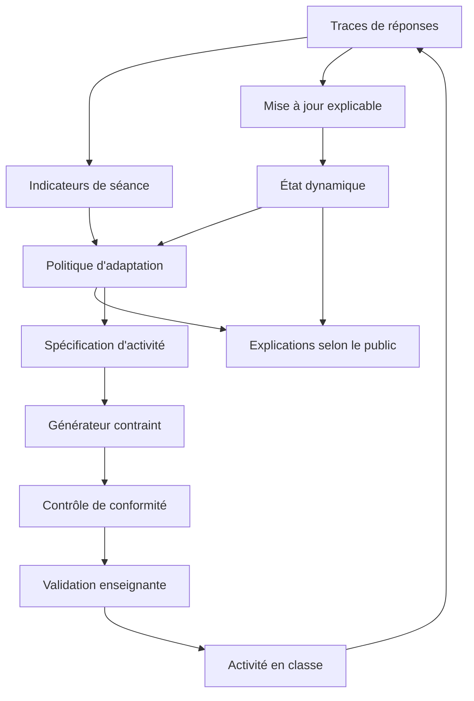

# Conception d'un modèle intelligent, dynamique et explicable de l'apprenant

Intégration de l'intelligence artificielle, des learning analytics et de l'IA générative pour l'adaptation pédagogique en compréhension écrite au primaire.

Version du modèle de référence : 0.1.0. Les équations ci-dessous décrivent l'implémentation du paquet `modele_apprenant`. Les hyperparamètres numériques sont provisoires. Ils vivent dans `src/modele_apprenant/constantes.py` et peuvent être recalibrés sans changer l'architecture.

## 1. Objet

Le modèle estime, au fil des activités, ce qu'un élève de cycle 2 ou de cycle 3 est en train de consolider en compréhension écrite. À partir de cet état, il propose une activité du jour : longueur et langue du texte, processus de compréhension visés, étayage, durée. Il explique la proposition à l'enseignant, et il formule un message d'activité pour l'élève et un message bref pour la famille.

Trois fonctions restent séparées.

- L'intelligence artificielle symbolique tient l'état de compétences et choisit l'adaptation.
- Les learning analytics transforment les traces de la séance en indicateurs de comportement de réponse.
- L'IA générative, ou à défaut un générateur par gabarits, rédige le texte et les questions à partir d'une spécification déjà figée.

L'enseignant valide, ajuste ou écarte la proposition avant la passation.

## 2. Situation pédagogique

En lecture, au primaire, la compréhension écrite se construit en même temps que la reconnaissance des mots, la fluence, le vocabulaire et le traitement de la phrase. Un même élève peut retrouver une information écrite dans le texte et peiner encore à comprendre une cause, une intention ou l'idée d'ensemble. L'adaptation utile porte alors sur le processus demandé et sur l'étayage, tout en gardant un texte que l'élève peut lire.

Le modèle sert cette différenciation. Il prépare une proposition argumentée. Il laisse à l'enseignant le jugement sur ce qui se passe dans la classe : lecture à voix haute, échanges, connaissances du texte, climat du moment.

## 3. Invariants

1. Deux canaux de maîtrise coexistent : la réussite autonome et la réussite assistée.
2. La bande linguistique qualifie le texte proposé aujourd'hui. Elle qualifie la lisibilité du support.
3. La demande cognitive des questions est réglée à part de la difficulté linguistique du texte.
4. Chaque mise à jour garde une trace de responsabilité : quelle compétence a reçu le crédit ou la révision, et pourquoi.
5. Tant que les observations manquent, le modèle sonde au lieu d'engager une longue séance.
6. Un prérequis déjà observé et encore en deçà du seuil ramène le travail vers ce prérequis.
7. Les indicateurs d'engagement décrivent la séance en cours. Ils ne deviennent pas un trait durable de l'élève.
8. Le générateur reçoit une spécification. Il ne recalcule pas les maîtrises.
9. Toute proposition exige une validation enseignante.
10. Les données restent minimales : pseudonyme, niveau, thèmes choisis, aménagements saisis par l'enseignant, traces d'activité.

## 4. Ancrages

L'ontologie croise trois cadres compatibles.

La vue simple de la lecture relie la compréhension de l'écrit à la reconnaissance des mots et à la compréhension du langage (Gough et Tunmer, 1986 ; Hoover et Gough, 1990). Le décodage et la fluence y figurent comme fondations, aux côtés du vocabulaire et de la phrase.

Giasson organise la compréhension en microprocessus, processus d'intégration, macroprocessus, processus d'élaboration et processus métacognitifs. Le modèle reprend ces familles pour le vocabulaire, la phrase, la cohésion, les inférences, le sens global, la justification, les stratégies et l'autorégulation.

PIRLS décrit quatre processus de lecture : prélever une information explicite, réaliser des inférences, interpréter et intégrer, examiner et évaluer (Mullis et Martin, 2019). Ils correspondent ici aux compétences EXP, INF, MAC et EVA. La cohésion (COH) prépare les inférences locales.

La construction du sens s'appuie aussi sur l'intégration d'un modèle de situation (Kintsch, 1988, 1998) et sur la métaphore de la corde de lecture, qui tient ensemble les fils linguistiques et les fils de compréhension (Scarborough, 2001). L'enseignement explicite des stratégies, travaillé dans les classes francophones notamment à la suite des recherches sur la lecture et l'écriture au primaire (Goigoux, 2016), justifie une compétence de stratégies distincte du score de compréhension.

L'adaptation reprend la zone proximale de développement (Vygotsky, 1978) et l'étayage tutoral (Wood, Bruner et Ross, 1976) : la réussite visée se situe au-dessus du hasard et en deçà de la tâche déjà maîtrisée sans aide. L'état ouvert à l'enseignant s'inscrit dans les modèles ouverts de l'apprenant (Bull et Kay, 2016). La mise à jour s'inspire du knowledge tracing (Corbett et Anderson, 1994) et de l'idée de matrice Q des modèles diagnostiques cognitifs (Tatsuoka, 1983 ; de la Torre, 2009), sous une forme dont chaque facteur reste nommable.

Les learning analytics sont entendus comme la mesure, le recueil, l'analyse et la communication des données d'apprentissage, au service de la compréhension et de l'optimisation de l'apprentissage et de son contexte (Ferguson, 2012). Ici, le contexte décisionnel est la séance de compréhension, et le destinataire principal est l'enseignant.

## 5. Architecture

La boucle est : observer, estimer, proposer, faire valider, passer l'activité, observer à nouveau. Le générateur est remplaçable. Les gabarits locaux permettent de faire tourner la boucle sans service externe. Un grand modèle de langue peut occuper la même place, à condition de recevoir le même contrat de spécification et de passer le même contrôle.

## 6. Ontologie des compétences

| Code | Libellé | Famille | Repère PIRLS |
| --- | --- | --- | --- |
| DEC | Reconnaissance des mots | Fondations | — |
| FLU | Fluence | Fondations | — |
| VOC | Vocabulaire en contexte | Microprocessus | — |
| SYN | Compréhension de la phrase | Microprocessus | — |
| EXP | Prélèvement explicite | Prélèvement | Information explicitement énoncée |
| COH | Cohésion | Intégration | Relations proches entre phrases |
| INF | Inférences | Élaboration | Inférences |
| MAC | Sens global | Macroprocessus | Interpréter et intégrer |
| EVA | Justification | Élaboration | Examiner et évaluer |
| STR | Stratégies de compréhension | Métacognition | — |
| REG | Autorégulation | Métacognition | — |

Les prérequis forts relient ces compétences :

- FLU s'appuie sur DEC ;
- EXP s'appuie sur DEC et SYN ;
- COH s'appuie sur SYN ;
- INF s'appuie sur EXP, VOC et COH ;
- MAC s'appuie sur EXP et INF ;
- EVA s'appuie sur MAC et INF.

Les stratégies soutiennent les inférences, le sens global et la justification. L'autorégulation soutient les stratégies. Un soutien modifie la réussite estimée. Il n'interdit pas de travailler la compétence cible.

Les priors de début de niveau et les attendus de fin de niveau sont des ancres provisoires, distinctes pour le CP, le CE1, le CE2, le CM1 et le CM2. L'écart entre la maîtrise estimée et l'attendu du niveau sert à prioriser le travail. Une équipe peut remplacer ces attendus par sa progression locale. Les poids didactiques diffèrent selon le cycle : au cycle 2, la fluence, le prélèvement et les inférences pèsent davantage ; au cycle 3, le sens global, les inférences et la justification prennent plus de place.

## 7. État dynamique

Pour chaque compétence, deux lois Bêta conservent des pseudo-effectifs.

\[
\pi = \frac{\alpha}{\alpha+\beta}
\]

Le canal autonome reçoit les réponses sans aide. Le canal assisté reçoit les réponses produites avec au moins une aide. Les deux canaux partent du même prior de niveau. Le prior vaut huit observations fictives (`KAPPA_PRIOR = 8`) : il oriente les premières séances, puis les traces le dépassent.

L'incertitude affichée est l'écart-type de la loi Bêta, divisé par l'écart-type d'une loi uniforme sur \([0,1]\) et borné à 1. Une fiabilité élevée correspond à une incertitude basse. La vitesse est une moyenne glissante des derniers changements de maîtrise autonome. Elle indique un mouvement récent, en progression, stable ou en recul.

Entre deux observations séparées de \(\Delta\) jours, les comptes reviennent vers le prior :

\[
\alpha' = \alpha_0 + (\alpha-\alpha_0)\,e^{-\lambda \Delta}, \quad \lambda = 0{,}01
\]

La même contraction s'applique à \(\beta\), aux preuves et à la vitesse, sur les deux canaux. La demi-vie est d'environ soixante-neuf jours. Une période sans trace, par exemple des vacances, réduit la certitude et rapproche doucement l'estimation de l'ancre de niveau. L'identité \(\alpha+\beta = \alpha_0+\beta_0+\text{preuves}\) est conservée par les mises à jour et par cet écoulement.

L'état exporté pour un tableau de bord contient le pseudonyme, le niveau, le score linguistique du jour et, pour chaque compétence, les deux maîtrises, l'incertitude, les preuves et la vitesse. Cet export est le support d'un modèle ouvert côté enseignant.

## 8. Traces et learning analytics

Une trace est une réponse déjà reliée à sa matrice Q. Elle porte :

- l'identifiant de l'item et celui de la séance ;
- les compétences exigées par l'item, et le processus principal ;
- la réussite ;
- la demande cognitive et la difficulté linguistique, chacune entre 0 et 1 ;
- le temps de réponse, le nombre d'aides, le nombre de relectures ;
- une confiance facultative entre 0 et 1 ;
- un indicateur d'abandon ;
- le moment, en jours.

Le profil d'élève contient un pseudonyme, le niveau, les thèmes choisis dans une liste fermée, et deux aménagements saisis par l'enseignant : consigne accessible, lecture par l'adulte possible. Le modèle ne déduit ni une langue familiale, ni un diagnostic, ni une situation sociale.

Sur la séance en cours, les indicateurs résument la proportion de réussites, de réponses très rapides (moins de quatre secondes), d'aides, d'abandons et de relectures, ainsi que l'écart moyen entre confiance et réussite lorsque la confiance est connue. Une nouvelle séance remet ces indicateurs à zéro. L'état de compétences, lui, se poursuit.

## 9. Mise à jour explicable

La réussite attendue d'un item, avant observation, est

\[
\begin{aligned}
P(X=1) = \sigma\Big(&\,0{,}30 + 0{,}90\,\overline{\mathrm{logit}(\pi_k)} \\
&+ 0{,}40\,(\pi_{\mathrm{STR}}-0{,}5)\,\mathbf{1}_{\text{stratégie}} \\
&- 1{,}10\,(d-0{,}5) - 0{,}80\,(\ell - s) + e(a, p)\Big)
\end{aligned}
\]

où \(\overline{\mathrm{logit}(\pi_k)}\) est la moyenne des logits des compétences de la matrice Q, \(d\) la demande cognitive, \(\ell\) la difficulté linguistique du texte, \(s\) le score linguistique de l'élève, et \(e(a,p)\) le bonus d'étayage selon l'aide \(a\) et le processus \(p\). Le terme de stratégie s'ajoute pour la cohésion, les inférences, le sens global et la justification, lorsque la stratégie n'est pas déjà dans la matrice Q.

Cette forme est compensatoire : des compétences exigées ensemble se combinent par la moyenne de leurs logits. Elle reste lisible. Elle approxime un modèle diagnostique ; elle ne le remplace pas sous une inférence bayésienne complète.

Lorsqu'une réponse arrive, sa masse de départ vaut 1, puis elle est modulée.

- Un abandon multiplie la masse par 0,40.
- Une réponse inférieure à quatre secondes la multiplie par 0,30.
- Le facteur de surprise vaut \(0{,}40 + 0{,}60 \times \text{surprise}\). La surprise est \(1-P\) si la réponse autonome est réussie, et \(P\) sinon. Une issue inattendue pèse plus. Une issue attendue pèse encore un peu.
- Sans aide, toute la masse va au canal autonome.
- Avec aide et réussite, 15 % vont au canal autonome et 85 % au canal assisté.
- Avec aide et réponse non réussie, 70 % vont au canal autonome et 45 % au canal assisté : l'aide n'a pas suffi, et cela renseigne surtout la maîtrise autonome.

La masse est ensuite répartie entre les compétences de l'item. En cas de réussite, la part d'une compétence est proportionnelle à \(0{,}25 + 0{,}75\pi\). En cas de réponse non réussie, elle est proportionnelle à \(0{,}25 + 0{,}75(1-\pi)\). Le crédit va davantage aux compétences déjà solides. La révision va davantage aux compétences les plus basses parmi celles que l'item demandait. Les parts sont normalisées : une observation vaut une seule masse, même si l'item charge plusieurs compétences.

Deux mises à jour métacognitives, de petite masse, complètent la matrice Q.

- Une relecture apporte une évidence positive d'autorégulation. Si la réponse est réussie sans aide, elle apporte aussi une évidence de stratégie.
- Un écart d'au moins 0,55 entre la confiance et la réussite diminue l'autorégulation. Un écart d'au plus 0,25 l'augmente légèrement.

Le journal conserve, pour chaque trace récente, la probabilité estimée avant mise à jour, le facteur de surprise, la qualité de la preuve, les responsabilités et les variations de maîtrise. L'explication de l'enseignant peut donc dire quelle compétence a porté la dernière révision.

## 10. Politique d'adaptation

La politique est lexicographique. Chaque règle a un identifiant stable.

La priorité d'une compétence est

\[
\rho = \max(0, a-\pi) \times z(\pi) \times \tilde f \times \omega \times \lambda
\]

\(a\) est l'attendu du niveau, \(z(\pi)\) vaut 1 dans l'intervalle \([0{,}30\,;\,0{,}82]\) et 0,65 en dehors, \(\omega\) est le poids didactique du cycle, et \(\lambda\) vaut 0,25 lorsque la compétence est bloquée, 1 sinon. La fiabilité effective \(\tilde f\) vaut \(0{,}55 + 0{,}45(1-u)\), afin qu'une compétence encore peu observée conserve un rang, avec un plancher. À scores égaux, l'ordre de l'ontologie départage.

Une compétence est bloquée lorsqu'un prérequis fort a déjà au moins une observation équivalente et une maîtrise autonome inférieure à 0,45. Sans observation du prérequis, le modèle ne bloque pas : il ne transforme pas le prior en interdiction.

Ordre des décisions :

1. **R5 — retour au prérequis.** Si la compétence la plus prioritaire est bloquée, le foyer devient le prérequis bloquant le plus bas.
2. **R1 — régulation d'engagement.** Dès quatre réponses dans la séance, si au moins la moitié sont très rapides et au plus 40 % sont réussies, ou si au moins 40 % sont abandonnées, l'activité est raccourcie à quatre questions et huit minutes. Elle commence par le prélèvement explicite. Le modelage est écarté de cette régulation.
3. **R3 — enrichissement.** Si la fluence, le vocabulaire, le prélèvement, les inférences et le sens global atteignent l'attendu, avec au moins quatre observations et une incertitude d'au plus 0,40, la séance vise la justification, ou le sens global si la justification est déjà au niveau de l'attendu. La demande cognitive monte. La bande du texte peut gagner un cran lorsque la reconnaissance des mots et la fluence le permettent.
4. **R2 — sondage.** Si la compétence focale a moins d'une observation équivalente, la séance est un court sondage de six questions, sans étayage, pour voir la réussite autonome. Le prélèvement explicite y figure toujours (R10), avec la compétence focale et la priorité suivante.
5. **R4 — consolidation.** Dans les autres cas, la séance consolide la compétence focale, maintient le prélèvement, reprend le prérequis le plus juste et, lorsque c'est pertinent, ouvre un pas vers le processus suivant.

La bande linguistique est calculée à part (R7), à partir du score

\[
s = 0{,}25\,\pi_{\mathrm{DEC}} + 0{,}25\,\pi_{\mathrm{FLU}} + 0{,}20\,\pi_{\mathrm{VOC}} + 0{,}15\,\pi_{\mathrm{SYN}} + 0{,}15\,\pi_{\mathrm{EXP}}
\]

Les seuils 0,38, 0,50, 0,62 et 0,74 donnent cinq bandes, d'un texte très court à un texte plus long. Aux priors provisoires, la bande de départ est 1 au CP, 2 au CE1, 3 au CE2, 4 au CM1 et 4 au CM2. La bande 5 correspond à un score linguistique d'au moins 0,74, ou au cran supplémentaire de l'enrichissement. La demande cognitive (R8) vaut 0,30, 0,42, 0,55 ou 0,68 selon la maîtrise focale. Pour le sondage elle vaut 0,40. Pour l'enrichissement elle vaut 0,72. Le texte proposé est aligné sur le score linguistique de l'élève, de sorte que la probabilité estimée reflète surtout le processus et l'étayage.

L'étayage (R6) est le plus léger, parmi ceux qui ont un sens pour la compétence, dont la réussite estimée atteint 0,60. L'ordre pour les inférences est : aucun, rappel de stratégie, repérage des connecteurs, modelage. Si aucun étayage de la liste n'atteint 0,60, le plus engagé est proposé avec une mise en garde, et la réussite sous modelage reste comptée dans le canal assisté. La règle R9 rappelle que l'enseignant valide.

La probabilité visée autour de 0,60 est un plancher de zone proximale, pas une note à faire atteindre à tout prix. Au-dessus, l'élève peut travailler sans aide nouvelle. En dessous, l'étayage augmente d'un cran.

## 11. Explicabilité

Cinq couches composent l'explication.

| Couche | Contenu | Public |
| --- | --- | --- |
| Locale | Dernière réponse, probabilité alors estimée, compétence qui porte la révision | Enseignant |
| État | Maîtrise autonome, maîtrise assistée, incertitude, preuves, tendance | Enseignant |
| Décision | Règles déclenchées, bande, demande, répartition, étayage, probabilités avec et sans étayage | Enseignant |
| Contrefactuel | Ce que deviendrait la proposition si la compétence focale était à 0,85 | Enseignant |
| Activité | Geste du jour et outil de lecture, sans score | Élève |
| Étape | Compétence travaillée, sans classement et sans comparaison | Famille |

Le message élève nomme le travail du jour et un outil : relire, avancer phrase par phrase, repérer un connecteur, ou chercher l'indice avec l'adulte pour la première question. Le message famille décrit l'étape de travail. Les estimations chiffrées restent un outil professionnel.

Le contrefactuel ne change qu'une compétence, à 0,85, avec assez d'observations pour que cette valeur soit tenue pour informée. Le reste de l'état et les indicateurs de séance restent en place. Si la séance appelle déjà une régulation d'engagement, le contrefactuel le dit : l'activité courte demeurerait. Si la compétence suivante est encore peu observée, la proposition peut redevenir un sondage. Cette réponse évite de présenter la prochaine cible comme un constat définitif.

Les formulations évitent les étiquettes stigmatisantes. Le contrôle automatique rejette, dans le texte destiné à l'élève, des mots comme « faible », « nul », « paresseux » ou un terme de diagnostic.

## 12. IA générative contrainte

La spécification transmise au générateur contient le niveau, le thème retenu, la bande et la fourchette de longueur, la demande cognitive, la compétence focale, la répartition des processus, l'étayage et ses consignes, la possibilité d'une lecture par l'adulte, et des contraintes de rédaction.

Le thème est le premier thème choisi par l'élève dans la liste : nature, animaux, école, sport, sciences. Hors de cette liste, le thème de repli est la nature.

Les contraintes demandent un texte original, adapté au primaire, sans violence ni humiliation ; des questions étiquetées par un processus de la spécification ; une réponse attendue et un indice textuel pour l'enseignant ; l'absence de jugement sur l'élève ; l'interdiction de modifier la compétence focale ou d'inventer une maîtrise.

Le générateur par gabarits réalise ce contrat avec cinq textes originaux. Il coupe le passage selon la bande, et il l'allonge seulement si l'indice de la question demandée se trouve plus loin. La note enseignante signale cet allongement. Un rédacteur génératif devra, lui, tenir la longueur de bande tout en plaçant l'indice dans le passage. Le contrôle vérifie le thème, la présence de la compétence focale, l'appartenance des processus à la spécification, l'existence d'une réponse et d'un indice, et le lexique du texte élève.

Tant que des alertes sont présentes, la note enseignante demande de revoir l'activité. Même sans alerte, la validation humaine reste requise. Les gabarits sont des conducteurs de séance, avec des réponses connues, et non un manuel littéraire figé.

## 13. Éthique, protection des données, place de l'adulte

Le modèle est conçu pour des enfants. Le pseudonyme ne contient ni espace ni adresse. L'export d'état ne contient pas de texte libre sur la vie de l'élève. Les thèmes viennent d'une liste choisie en classe. Les aménagements de consigne et de lecture par l'adulte sont des décisions professionnelles saisies par l'enseignant.

La finalité est l'adaptation d'une activité de compréhension. Le modèle prépare une recommandation. Il n'oriente pas, ne sanctionne pas et ne classe pas les élèves entre eux. Cette place de l'enseignant répond à l'exigence d'une intervention humaine lorsque une décision automatisée produirait un effet significatif (article 22 du RGPD), et au principe de minimisation (article 5). L'explication enseignante fournit les éléments utiles pour comprendre la proposition, au sens de l'information due sur une logique automatisée (article 12).

Les lignes directrices européennes sur l'IA et les données à l'école (Commission européenne, 2022) conduisent aux mêmes choix : finalité pédagogique claire, supervision humaine, transparence proportionnée à l'âge, absence de surveillance déguisée. L'écoulement des preuves est une propriété statistique du modèle. La durée de conservation légale des traces reste à fixer par l'école ou la collectivité, dans son registre et selon le cadre national applicable.

Un tableau de bord de classe peut agréger des comptes de processus travaillés. Cette agrégation ne réentre pas dans le calcul individuel comme une norme de comparaison.

## 14. Ce que la version 0.1.0 vérifie

Les tests automatiques vérifient des propriétés internes.

- Le référentiel, les prérequis, les priors et les attendus sont complets et ordonnés.
- Une réussite augmente la maîtrise visée, une réponse non réussie la diminue, et l'identité des lois Bêta est conservée.
- Sur un item à deux compétences, la révision se porte surtout sur la plus basse.
- Une réussite aidée déplace surtout le canal assisté.
- Une réponse trop rapide pèse moins qu'une réponse posée, et une série de réponses rapides et non réussies déclenche la régulation de séance.
- Une relecture réussie soutient les stratégies. Une confiance très élevée suivie d'une réponse non réussie diminue l'autorégulation.
- Après une longue interruption, l'estimation se rapproche du prior et les preuves diminuent.
- La probabilité croît avec la maîtrise et avec l'étayage, et elle décroît quand la demande cognitive augmente.
- Sans observation, un élève de CE2 est sondé sur les inférences, avec le prélèvement explicite dans le sondage. Un élève de CM2 est sondé d'abord sur la justification, avec le même ancrage explicite.
- Si les inférences sont prioritaires alors que la cohésion observée est sous le seuil, le travail revient à la cohésion.
- Lorsque les compétences centrales sont hautes et informées, la décision devient un enrichissement.
- Le scénario de CE2 produit une consolidation des inférences, un texte de bande 3, un étayage de connecteurs, une activité conforme et des messages sans score pour l'élève et la famille.
- Le validateur signale une question dont le processus n'est pas dans la spécification.

Ces tests ne mesurent pas l'apprentissage d'élèves réels. Avant un usage en classe, il reste à calibrer les priors, les attendus et l'échelle de probabilité sur des réponses authentiques ; à faire relire l'ontologie et les formulations par des enseignants de cycle 2 et de cycle 3 ; à étudier la fidélité des explications, c'est-à-dire leur correspondance avec les règles déclenchées, et leur utilité en préparation de séance ; à vérifier que la qualité prédictive est comparable entre groupes d'élèves lorsque des données le permettent, sans introduire d'attribut sensible dans le calcul.

## 15. Limites

La matrice Q est déclarée par le concepteur de l'item. Une étiquette de processus inexacte déplacerait l'état. Le contrôle de la spécification limite ce risque pour les activités produites par le système. Il ne corrige pas un exercice importé d'ailleurs avec une mauvaise étiquette.

La combinaison par moyenne de logits ignore une partie des dépendances fines entre compétences. Le journal de responsabilité compense cette simplicité du point de vue de l'explication. Un modèle diagnostique estimé par ailleurs peut remplacer la fonction de mise à jour si l'ontologie, les deux canaux et la politique restent les interfaces.

Les gabarits ne réécrivent pas finement le lexique de chaque bande. Ils règlent surtout la longueur et le lieu de l'indice. La fluence et la reconnaissance des mots sont dans l'état, mais le scénario de référence n'observe que des questions de compréhension. Une trace de lecture à voix haute, codée sur DEC ou FLU, emprunte la même mise à jour.

Les nombres de la version 0.1.0 sont des hypothèses d'ingénierie. Les changer modifie les seuils de décision. L'architecture — ontologie, canaux, journal, règles nommées, spécification, validation enseignante — est faite pour supporter cette calibration.

## 16. Scénario de référence

Le script `exemples/scenario_ce2.py` initialise un élève pseudonymisé de CE2 dont le thème choisi est les animaux. Quatre prélèvements explicites sont réussis, posément. Quatre inférences ne le sont pas, posément aussi, avec une relecture sur la première. Aucune aide n'est utilisée.

La mise à jour élève le prélèvement et abaisse les inférences. La décision est une consolidation des inférences, sur un texte de bande 3, avec le repérage des connecteurs comme étayage le plus léger qui ramène la réussite estimée au-dessus de 0,60. La répartition mêle les inférences, le maintien du prélèvement, la cohésion et un pas vers le sens global. L'explication enseignante donne les deux canaux, la dernière responsabilité, les règles, l'incertitude restante et un contrefactuel. Le message élève propose l'outil des connecteurs, sans score. L'activité gabarit est un court récit original, le hérisson du jardin, dont les questions portent les processus demandés et dont le contrôle automatique ne signale aucune alerte.

Ce scénario illustre la dynamique du modèle. Il ne décrit pas un élève réel et ne mesure pas un gain d'apprentissage.

## 17. Correspondance avec le code

| Concept | Module |
| --- | --- |
| Ontologie, priors, attendus, étayages | `ontologie.py` |
| Hyperparamètres provisoires et libellés des règles | `constantes.py` |
| Profil, trace, matrice Q | `traces.py` |
| Canaux Bêta, écoulement, export | `etat.py` |
| Probabilité, surprise, responsabilités | `inference.py` |
| Indicateurs de séance, profil ouvert | `analytique.py` |
| Priorités et politique | `adaptation.py` |
| Explications et contrefactuels | `explication.py` |
| Spécification, gabarits, contrôle, prompt | `generation.py` |
| Façade `initialiser`, `observer`, `proposer`, `expliquer`, `generer` | `modele.py` |

La façade `ModeleApprenant` enchaîne ces étapes. Un générateur externe peut remplacer `GenerateurParGabarits` s'il expose `generer(specification)`.

## Références

Bull, S. et Kay, J. (2016). SMILI☺: A framework for interfaces to learning data in open learner models, learning analytics and related fields. *International Journal of Artificial Intelligence in Education, 26*(1), 293–331.

Commission européenne. (2022). *Lignes directrices éthiques sur l'utilisation de l'intelligence artificielle et des données dans l'enseignement et l'apprentissage à l'intention des éducateurs*. Office des publications de l'Union européenne.

Corbett, A. T. et Anderson, J. R. (1994). Knowledge tracing: Modeling the acquisition of procedural knowledge. *User Modeling and User-Adapted Interaction, 4*(4), 253–278.

de la Torre, J. (2009). DINA model and parameter estimation: A didactic. *Journal of Educational and Behavioral Statistics, 34*(1), 115–130.

Ferguson, R. (2012). Learning analytics: Drivers, developments and challenges. *International Journal of Technology Enhanced Learning, 4*(5/6), 304–317.

Giasson, J. (2012). *La compréhension en lecture* (3e éd.). De Boeck.

Goigoux, R. (dir.). (2016). *Lire et écrire. Étude de l'influence des pratiques d'enseignement de la lecture et de l'écriture sur la qualité des premiers apprentissages*. Institut français de l'éducation.

Gough, P. B. et Tunmer, W. E. (1986). Decoding, reading, and reading disability. *Remedial and Special Education, 7*(1), 6–10.

Hoover, W. A. et Gough, P. B. (1990). The simple view of reading. *Reading and Writing, 2*(2), 127–160.

Kintsch, W. (1988). The role of knowledge in discourse comprehension: A construction-integration model. *Psychological Review, 95*(2), 163–182.

Kintsch, W. (1998). *Comprehension: A paradigm for cognition*. Cambridge University Press.

Mullis, I. V. S. et Martin, M. O. (dir.). (2019). *PIRLS 2021 assessment frameworks*. TIMSS & PIRLS International Study Center.

Règlement (UE) 2016/679 du Parlement européen et du Conseil du 27 avril 2016 relatif à la protection des personnes physiques à l'égard du traitement des données à caractère personnel (RGPD).

Scarborough, H. S. (2001). Connecting early language and literacy to later reading (dis)abilities. Dans S. B. Neuman et D. K. Dickinson (dir.), *Handbook of early literacy research* (p. 97–110). Guilford Press.

Tatsuoka, K. K. (1983). Rule space: An approach for dealing with misconceptions based on item response theory. *Journal of Educational Measurement, 20*(4), 345–354.

Vygotsky, L. S. (1978). *Mind in society: The development of higher psychological processes*. Harvard University Press.

Wood, D., Bruner, J. S. et Ross, G. (1976). The role of tutoring in problem solving. *Journal of Child Psychology and Psychiatry, 17*(2), 89–100.
